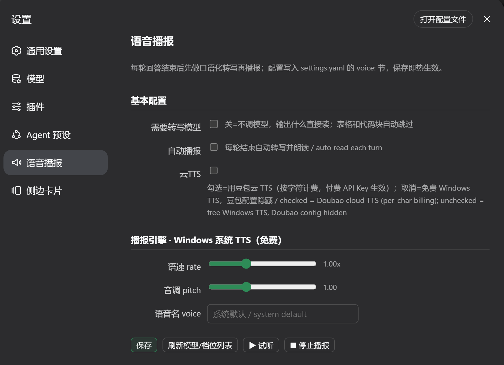

# voice-for-dsh

[](https://github.com/junarch/voice_for_dsh/actions/workflows/test.yml)

给 [DeepSeek Harness Web](https://github.com/deepseek-ai/dsh)（dsh web）加"输出朗读"能力的语音插件：
每轮 DeepSeek 输出结束后，先把输出做**口语化转写**（代码/表格/Markdown 等不适合朗读的内容改写为口语），
再通过 TTS 播报出来。

> 一句话：**让 dsh 开口说话。** 开开关 = 每轮结束自动播报；关 = 不自动，但每条助手消息上有"朗读"按钮手动播。

---

## 功能

- **自动播报开关**：开 = 每轮结束自动"转写 + 播报"；关 = 不自动，保留手动按钮。
- **每消息"朗读"按钮**：手动转写并播报该条输出；已完整朗读过的消息旁有 **↻ 重新生成**按钮
  （跳过转写缓存，用当前配置重新转写 + 合成）。
- **转写（LLM）**：代码块/表格/URL/Markdown 标记改写为口语文稿，不逐字朗读原文。
- **TTS 双引擎**：
  - `browser`：浏览器 `speechSynthesis`（零配置、免费、离线兜底）；
  - `volcengine`：豆包语音合成 2.0（双向流 WebSocket 默认 + HTTP 单向兜底），
    8 种方言、中英文音色、情感演绎指令；网关可配（`plan` 智能体套餐 /
    `standard` 标准付费 / `custom` 自定义端点，仅端点路径不同，鉴权一致）。
- **省钱设计**（详见下方"成本与隐私"）：
  - 同一消息重复朗读 → 转写缓存命中，**零新增 LLM 调用**；
  - 重播同一消息 1h 内 → 豆包**服务端缓存命中，免重合成、不重复计费**；
  - 转写失败自动降级为"原文直读"，不中断使用。

## 截图


*对话：每条消息的朗读按钮、已朗读徽标与自动朗读开关*



*设置页：转写/引擎/语种方言/音色与试听*

---

## 平台支持

- **Windows**：✅ 已实测（开发与发布均基于 Windows）。
- **macOS / Linux**：⚠️ 未实测。Host 半逻辑已在 CI（`ubuntu-latest`）上跑通零成本测试；
  未验证的是浏览器语音引擎行为（`speechSynthesis`）与界面交互。欢迎在 Mac/Linux 上试用并反馈
  （见 [`docs/ROADMAP.md`](docs/ROADMAP.md)）。

## 安装

> 插件是 dsh 的 **bundle**（`packages/dsh-plugin-voice`），通过 `dsh plugin --profile web add` 装进
> `web` profile。以下命令假设你已经装好 dsh（未全局安装时用 `npx @deepseek-ai/dsh` 前缀）。

### 前置要求

- Node.js 22+（双向流播报依赖 Node 22 的全局 `WebSocket`；仅用浏览器 TTS 时可低至 18+）
- dsh（`@deepseek-ai/dsh@0.1.0-rc.6` 或兼容版本）
- （可选）火山方舟 API Key，用于豆包 TTS；不配则用浏览器语音兜底

### 从 clone 安装

```bash
git clone https://github.com/junarch/voice_for_dsh.git
cd voice_for_dsh

# 1) 安装插件自身依赖
cd packages/dsh-plugin-voice && npm install && cd ../..
#    （若提示 peer 依赖 ERESOLVE，改用 npm install --legacy-peer-deps）

# 2) 把插件装进 web profile（<path> 换成仓库绝对路径或相对路径）
npx @deepseek-ai/dsh plugin --profile web add link:packages/dsh-plugin-voice

# 3) 启动 dsh web
npx @deepseek-ai/dsh web
```

浏览器打开 `http://127.0.0.1:3080`，在设置页找到"语音播报"即可配置。

> 提示：`dsh plugin add` 的相对路径锚定到**执行命令时的当前目录**；若解析失败，直接给绝对路径
> （如 `link:C:\path\to\voice_for_dsh\packages\dsh-plugin-voice`）。

### 配置

所有配置在 `settings.yaml` 的 `voice:` 命名空间，设置页可可视化编辑。字段说明见
[`docs/pipeline.md` §6](docs/pipeline.md)。

---

## 成本与隐私（请先读）

- **转写**：每次"首次朗读"会调用一次你配置的 LLM（settings.yaml 里的 provider），**花 token**。
  - 同一消息重复朗读不花（转写缓存命中）；重新生成（↻）会重新转写（花）。
- **TTS**：浏览器语音免费；豆包 TTS 按字符/时长计费。
  - 同一消息 **1h 内重播** → 豆包服务端缓存命中，**不重复计费**。
- **隐私**：你的对话内容会发送给你配置的第三方服务（转写 LLM、豆包 TTS）。**在涉及敏感内容的会话里请谨慎。**
- 默认**不开启自动播报**；"云TTS"开关默认关（引擎 = 免费系统 TTS，全流程不花钱），
  需要时在设置页勾选"云TTS"（= 显式启用付费的豆包 API）。

---

## 开发与测试

```bash
# 零成本 mock 集成测试（覆盖转写/缓存/TTS/防重复计费等）
node scripts/test-host.mjs

# 真实外呼探针（花几分钱，验证火山接口行为）
node scripts/tts-cache-probe.mjs
```

- 测试方法论：[`docs/testing.md`](docs/testing.md)
- 开发手册：[`docs/development.md`](docs/development.md)
- 发布清单：[`docs/release.md`](docs/release.md)

## 文档

| 文档 | 内容 |
|---|---|
| [`docs/pipeline.md`](docs/pipeline.md) | 转写/TTS 管线行为 + `voice:` 配置 schema + 不变式 |
| [`docs/architecture.md`](docs/architecture.md) | DSH 插件机制与关键决策 |
| [`docs/development.md`](docs/development.md) | 开发循环 / 安装卸载 / 常见坑 |
| [`docs/testing.md`](docs/testing.md) | 测试方法（含账单防御） |
| [`docs/release.md`](docs/release.md) | 发布前清单 + 发版流程 |
| [`docs/providers.md`](docs/providers.md) | TTS/转写供应商接入规范（含本地 TTS） |
| [`docs/ROADMAP.md`](docs/ROADMAP.md) | 开发规划：多平台/新供应商/测试/安全收尾 |

## 贡献与安全

- 贡献指南：[`CONTRIBUTING.md`](CONTRIBUTING.md)
- 行为准则：[`CODE_OF_CONDUCT.md`](CODE_OF_CONDUCT.md)
- 报告安全漏洞：[`SECURITY.md`](SECURITY.md)（走 GitHub 私有漏洞报告，勿发公开 issue）

## 协议

[MIT](LICENSE)
