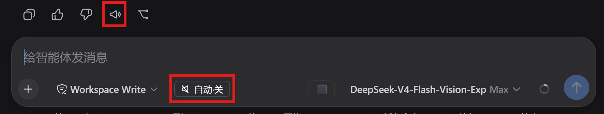
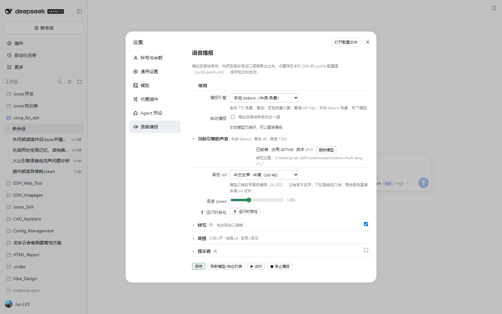
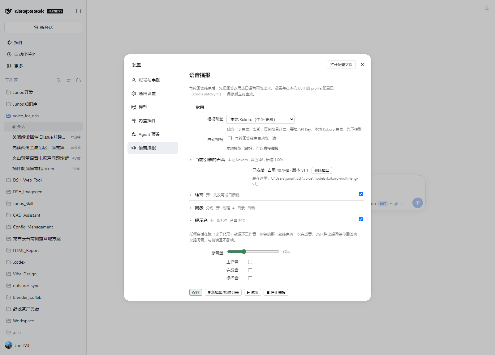

# voice-for-dsh

[](https://github.com/junarch/voice_for_dsh/actions/workflows/test.yml)

给 [DeepSeek Harness Web](https://github.com/deepseek-ai/dsh)（dsh web）加"输出朗读"能力的语音插件：
每轮 DeepSeek 输出结束后，先把输出做**口语化转写**（代码/表格/Markdown 等不适合朗读的内容改写为口语），
再通过 TTS 播报出来。

> 一句话：**让 dsh 开口说话。** 开开关 = 每轮结束自动播报；关 = 不自动，但每条助手消息上有"朗读"按钮手动播。

> **项目定位**：这是一个**个人项目**，围绕作者自己的使用习惯设计，不一定适合所有人。两种"进阶"引擎的定位不同：
> - **豆包（付费）**：情感化朗读——方言、多音色、情绪演绎，提供有趣的声音体验；
> - **本地 Kokoro（免费）**：进程内合成、离线、数据不出本机，中英都按原文读——
>   适合不想把内容发给云端、又想要稳定音质的场景。
>
> 只想给 dsh 加个"普通朗读"的话，默认的系统 TTS（浏览器语音）开箱即用、零配置；不认同上述思路也可随时切回。

---

## 功能

- **自动播报开关**：开 = 每轮结束自动"转写 + 播报"；关 = 不自动，保留手动按钮。
- **每消息"朗读"按钮**：手动转写并播报该条输出；已完整朗读过的消息旁有 **↻ 重新生成**按钮
  （跳过转写缓存，用当前配置重新转写 + 合成）。
- **转写（LLM）**：代码块/表格/URL/Markdown 标记改写为口语文稿，不逐字朗读原文。
- **三个播报引擎**：
  - **系统 TTS（浏览器语音）**（`browser`，默认）：浏览器 `speechSynthesis`，零配置、免费、离线兜底；
  - **豆包**（`volcengine`）：豆包语音合成 2.0（双向流 WebSocket 默认 + HTTP 单向兜底），
    8 种方言、中英文音色、情感演绎指令；网关可配（`plan` 智能体套餐 /
    `standard` 标准付费 / `custom` 自定义端点，仅端点路径不同，鉴权一致）；
  - **本地 Kokoro**（`local`）：Kokoro v1.1，免费、离线、数据不出本机、**不需要 Python**；
    中英都按原文读，合成在 dsh 进程内完成；模型在设置页一键下载，见 [`docs/local-tts.md`](docs/local-tts.md)。
- **提示音**：工作音（会话在跑）／完成音（跑完了）／提问音（DSH 在等你回答），默认整层关闭，
  可上传自己的音频；素材只存本机，与朗读互不影响。
- **省钱设计**（详见下方"成本与隐私"）：
  - 同一消息重复朗读 → 转写缓存命中，**零新增 LLM 调用**；
  - 重播同一消息 1h 内 → 豆包**服务端缓存命中，免重合成、不重复计费**；
  - 转写失败自动降级为"原文直读"，不中断使用。

## 截图



*对话：每条消息操作行里的「朗读」喇叭按钮（红框），输入框左侧的「自动」开关（红框）*



*设置页五层：常用（引擎 + 自动播报 + 一行状态）→ 当前引擎的声音（本地 Kokoro，已装 407MB 模型，含「运行时自检」）→ 转写 → 高级 → 提示音。其余四层收起，层头带当前值摘要*



*提示音层：总开关与总音量，工作音／完成音／提问音各自一行（可上传自定义音）*

---

## 平台支持

- **Windows**：✅ 已实测（开发与发布均基于 Windows）。
- **macOS / Linux**：⚠️ 未实测。零成本测试（`test-host.mjs` / `test-client.mjs` / 两个提示音套件）
  在 CI（`ubuntu-latest`）里配置并运行过，最近一次结果看页面顶部的徽章；未验证的是浏览器语音引擎行为
  （`speechSynthesis`）、界面交互，以及本地 Kokoro 的原生模块在你机器上能不能装上。欢迎在 Mac/Linux 上
  试用并反馈（见 [`docs/ROADMAP.md`](docs/ROADMAP.md)）。

## 安装

> 插件是 dsh 的 **bundle**（`packages/dsh-plugin-voice`），通过 `dsh plugin --profile desktop add` 装进
> `desktop` profile（DSH 桌面版）。

### 前置要求

- Node.js 22+（**只在从源码装包/跑脚本时需要**：`npm install` 与 `scripts/*.mjs`；桌面端运行插件不用另装
  Node——插件跑在桌面端自带的运行时里，豆包双向流用的全局 `WebSocket` 也由它提供）
- DSH 桌面版 `0.2.1-rc.3` 或更高的兼容版本（插件按 0.2.x 的插件 Config 模型实现）
- （可选）火山引擎语音合成 API Key（新版控制台「API 管理」页获取，见
  [快速入门](https://www.volcengine.com/docs/6561/2119699?lang=zh)），用于豆包；不配就用系统 TTS（浏览器语音）兜底

### 从 clone 安装

```powershell
git clone https://github.com/junarch/voice_for_dsh.git
cd voice_for_dsh

# 1) 安装插件自身依赖
cd packages/dsh-plugin-voice; npm install; cd ../..

# 2) 把插件装进 desktop profile（<path> 换成仓库绝对路径或相对路径）
#    桌面端自带 CLI（版本随桌面端，`dsh --version` 可查）：
$dsh = "$env:LOCALAPPDATA\Programs\DeepSeek Harness\resources\runtime\cli\bin\dsh.cmd"
& $dsh plugin --profile desktop add link:packages/dsh-plugin-voice

# 3) 从旧版（settings.yaml）升级的用户：把 voice 配置搬进 profile patch（先预览，确认后加 --write）
node scripts/migrate-voice-config.mjs
```

重启桌面端，在设置页找到"语音播报"即可配置。

> 提示：`link:` 的相对路径由 CLI 自己解析，锚定到哪个目录以 CLI 的实际行为为准（本仓库不对方向作承诺）。
> 解析失败（报 `cannot resolve profile bundle`）时改用绝对路径：
> `link:C:\path\to\voice_for_dsh\packages\dsh-plugin-voice`。

### 本地 TTS（可选，免费，中英都能读）

默认引擎是系统 TTS（浏览器语音），装完插件就能用。想离线朗读（本地 Kokoro v1.1，中英混读），模型要单独装
（下载 348MB、解包后 407MB，只存本机、不入 git）：设置页 →「语音播报」→ **常用** 层把「播报引擎」选成
**本地 Kokoro**，再到 **当前引擎的声音** 层的层头点 **下载模型**。插件自己下载、校验、解包，
进度可见、断点续传、装完就能用，**不需要重启**、不需要 Python、不需要启动服务——合成在 dsh 进程内完成。
装错了可以「删除模型」卸掉（只删插件装的那一份）。

来源、体积、失败分类、代理（`NODE_USE_ENV_PROXY=1`）、手动装法与排障见
[`docs/local-tts.md`](docs/local-tts.md)；**当前引擎的声音** 层里还有「🔌 运行时自检」按钮，会显示模型目录、
是否已加载、音色数与线程数。模型没装时点朗读会明确提示"模型未安装"，不会静默失败。

本地 Kokoro 默认走**分句流式**：按句切段、合成一段播一段，首声约 0.6 秒；要等整篇算完就把
**高级** 层的「分句流式播报」关掉。

### 配置

所有配置在目标 profile 的 `cordis.patch.yml` 里 `voice` 条目的 `config:`（设置页可可视化编辑，保存即写回该文件）。
字段说明见 [`docs/pipeline.md` §6](docs/pipeline.md)。豆包 API Key 也在这里（明文，本机私有，勿提交）。

---

## 成本与隐私（请先读）

- **转写**：每次"首次朗读"会调用一次你配置的 LLM（配置里的 provider），**花 token**。
  - 同一消息重复朗读不花（转写缓存命中）；重新生成（↻）会重新转写（花）。
- **播报**：系统 TTS（浏览器语音）免费；**本地 Kokoro 免费且内容不出本机**（仅转写仍走 LLM）；
  豆包按字符/时长计费，同一消息 **1h 内重播** → 服务端缓存命中，**不重复计费**。
- **磁盘与内存**：本地模型解包后 407MB（下载包 348MB，装完归档自动删掉）；加载后常驻内存约 0.5–0.6GB，
  不用本地引擎就不占。
- **隐私**：你的对话内容会发送给你配置的第三方服务（转写 LLM、豆包）；
  选本地 Kokoro 时合成完全在本机进行。**在涉及敏感内容的会话里请谨慎。**
- **提示音只存本机**：工作/完成/提问三种提示音（含你上传的自定义音）落在 `<DSH_HOME>/voice/sounds`，
  不上传、不走网络；单个文件上限 10MB。
- **崩溃范围是整个 Host**：本地合成是跑在 dsh Host 进程里的原生模块，它崩掉会带走整个 Host 进程，
  不只是这一条朗读——这是"不用装 Python、不用管端口"的代价。
- 默认**不开启自动播报**；引擎默认免费的系统 TTS（浏览器语音），全流程不花钱；需要豆包时在设置页切换
  （= 显式启用付费的豆包 API，自动播报成本门控随之生效）；本地 Kokoro 免费不受门控限制。

---

## 开发与测试

```bash
# 零成本 mock 集成测试（覆盖转写/缓存/播报/防重复计费等）
node scripts/test-host.mjs

# 零成本 Client 半合约测试（槽位注册 / 徽标 claim / i18n 键对齐）
node scripts/test-client.mjs

# 真实外呼探针（花几分钱，验证火山接口行为）
node scripts/tts-cache-probe.mjs
```

- 测试方法论：[`docs/testing.md`](docs/testing.md)
- 开发手册：[`docs/development.md`](docs/development.md)
- 发布清单：[`docs/release.md`](docs/release.md)

## 文档

| 文档 | 内容 |
|---|---|
| [`docs/pipeline.md`](docs/pipeline.md) | 转写/TTS 管线行为 + `voice:` 配置 schema + 不变式 |
| [`docs/local-tts.md`](docs/local-tts.md) | 本地 TTS：模型放哪/配置/音色/排障 |
| [`docs/architecture.md`](docs/architecture.md) | DSH 插件机制与关键决策 |
| [`docs/development.md`](docs/development.md) | 开发循环 / 安装卸载 / 常见坑 |
| [`docs/testing.md`](docs/testing.md) | 测试方法（含账单防御） |
| [`docs/release.md`](docs/release.md) | 发布前清单 + 发版流程 |
| [`docs/providers.md`](docs/providers.md) | TTS/转写供应商接入规范（含本地 TTS） |
| [`docs/ROADMAP.md`](docs/ROADMAP.md) | 开发规划：多平台/新供应商/测试/安全收尾 |

## 贡献与安全

- 贡献指南：[`CONTRIBUTING.md`](CONTRIBUTING.md)
- 行为准则：[`CODE_OF_CONDUCT.md`](CODE_OF_CONDUCT.md)
- 报告安全漏洞：[`SECURITY.md`](SECURITY.md)（走 GitHub 私有漏洞报告，勿发公开 issue）

## 协议

[MIT](LICENSE)
